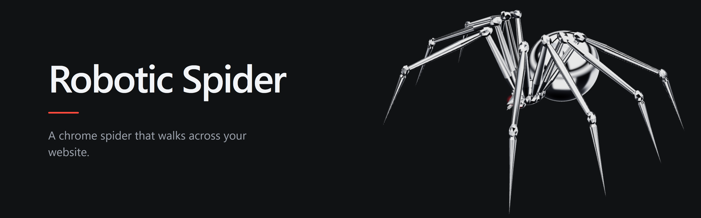
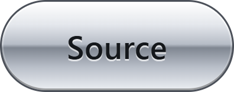
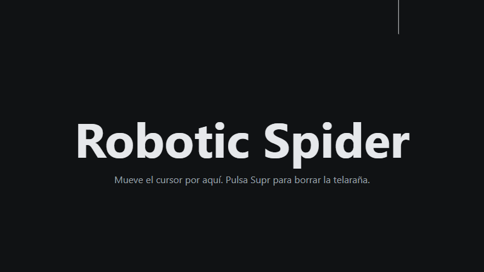

<div align="center">



<br />

<a href="#use-it-in-your-project"></a>&nbsp;
<a href="src/components/robotic-spider/"></a>&nbsp;
<a href="LICENSE"></a>

<br />

[Español](README.md) · **English**

</div>

<br />

<p align="center">
  
</p>

<br />

## What it is

A chrome robot spider that lives on your page. It is built entirely in code (no `.glb` files, no textures): procedural Three.js geometry, inverse-kinematics legs, and a body that reacts to the mouse and to scrolling.

It ships as an Astro component and only needs a couple of classes in your HTML.

<br />

## What it does

| | Behavior |
|---|---|
| **Chases the cursor** | Inside `.hero` it turns and speeds toward the mouse with smoothing (lerp). |
| **Spins a web** | It leaves long, sagging white threads tied to your `.anchor-point` elements. |
| **Gets bored** | If the mouse stays still for 2 s, it stops chasing and wanders on its own. |
| **Avoids your content** | Outside the hero it finds free paths (A\*) and never steps on text, cards, images or buttons. |
| **Side tunnel** | It leaves through one edge and comes back through the opposite one. |
| **Rappels down** | If scrolling pushes it off screen, it lowers itself on a silk thread. |
| **Stays out of the way** | Its canvas uses `pointer-events: none`, so it never blocks clicks or hover. |

<br />

## 3D viewer

The spider is exported as a 3D model in [`model/robotic-spider.stl`](model/robotic-spider.stl). GitHub opens it in an interactive viewer: drag to rotate and scroll to zoom. It shows the shape, without the chrome finish. The file also opens in Blender or any 3D program.

<br />

## Use it in your project

**1.** Copy the [`src/components/robotic-spider/`](src/components/robotic-spider/) folder into your project and install Three.js:

```bash
npm install three
```

**2.** Import it and place it once per page:

```astro
---
import RoboticSpider from "../components/robotic-spider/RoboticSpider.astro";
---
<section class="hero">
  <h1 class="anchor-point">Your title</h1>
</section>

<RoboticSpider />
```

**3.** Mark the hero and where the web should attach:

| Class | Purpose |
|---|---|
| `.hero` | Area where it chases the cursor and spins its web. |
| `.anchor-point` | Elements (usually the title) the web is tied to. |
| `[data-spider-ignore]` | Decorative backgrounds it can walk over. |

**Keyboard shortcut:** `Delete` clears the whole web.

<br />

## Settings

Everything is configured in [`config.ts`](src/components/robotic-spider/config.ts):

| Constant | Value | What it controls |
|---|---|---|
| `SPAN_PX` | `84` / `60` | Leg-tip to leg-tip size (desktop / small screen). |
| `WALK_SPEED` | `2.6` | Speed, in body spans per second. |
| `SLEEP_AFTER` | `2000` | ms of stillness before it stops chasing. |
| `IDLE_STYLE` | `"wander"` | `"wander"` strolls, `"sleep"` falls asleep, `"head"` turns into a blinking little head. |
| `WEB_MAX_ANCHORS` | `90` | Maximum trail anchors. |
| `KEEP_MAX` | `1400` | Maximum permanent threads over the title. |

<br />

## License

[MIT](LICENSE) © 2026 Melany Martínez
