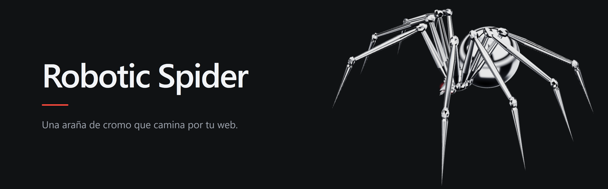
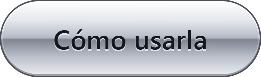
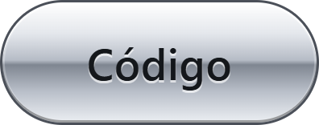
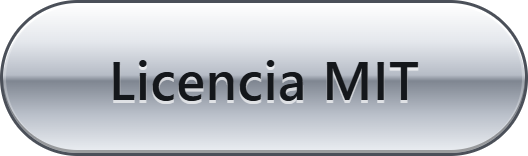

<div align="center">



<br />

<a href="#usarla-en-tu-proyecto"></a>&nbsp;
<a href="src/components/robotic-spider/"></a>&nbsp;
<a href="LICENSE"></a>

<br />

**Español** · [English](README.en.md)

</div>

<br />

## Qué es

Una araña robot de cromo que vive en tu página. Está hecha entera con código (sin archivos `.glb`, sin texturas): geometría procedural de Three.js, patas con cinemática inversa y un cuerpo que reacciona al ratón y al scroll.

Se usa como un componente de Astro y no pide nada más que un par de clases en tu HTML.

<br />

## Qué hace

| | Comportamiento |
|---|---|
| **Persigue el cursor** | Dentro del `.hero` gira y acelera hacia el ratón con suavizado (lerp). |
| **Teje telaraña** | Va dejando hilos blancos, combados y con pandeo, atados a los elementos `.anchor-point`. |
| **Se aburre** | Si el ratón lleva más de 2 s quieto, deja de seguirlo y pasea por su cuenta. |
| **Esquiva el contenido** | Fuera del hero busca rutas libres (A\*) y nunca pisa texto, tarjetas, imágenes ni botones. |
| **Túnel lateral** | Sale por un borde y reaparece por el contrario. |
| **Baja por su hilo** | Si el scroll la deja fuera de pantalla, desciende colgada de un hilo de seda. |
| **No estorba** | Su canvas tiene `pointer-events: none`: nunca bloquea clics ni hover. |

<br />

## Usarla en tu proyecto

**1.** Copia la carpeta [`src/components/robotic-spider/`](src/components/robotic-spider/) a tu proyecto e instala Three.js:

```bash
npm install three
```

**2.** Impórtala y colócala una vez por página:

```astro
---
import RoboticSpider from "../components/robotic-spider/RoboticSpider.astro";
---
<section class="hero">
  <h1 class="anchor-point">Tu título</h1>
</section>

<RoboticSpider />
```

**3.** Marca el hero y dónde quieres atar la red:

| Clase | Para qué sirve |
|---|---|
| `.hero` | Zona donde persigue el cursor y teje. |
| `.anchor-point` | Elementos (normalmente el título) a los que se ata la telaraña. |
| `[data-spider-ignore]` | Fondos decorativos por los que puede caminar encima. |

**Atajo de teclado:** `Supr` (Delete) borra toda la telaraña.

<br />

## Ajustes

Todo se configura en [`config.ts`](src/components/robotic-spider/config.ts):

| Constante | Valor | Qué controla |
|---|---|---|
| `SPAN_PX` | `84` / `60` | Tamaño de punta a punta de las patas (escritorio / pantalla pequeña). |
| `WALK_SPEED` | `2.6` | Velocidad, en envergaduras por segundo. |
| `SLEEP_AFTER` | `2000` | ms con el ratón quieto antes de dejar de perseguirlo. |
| `IDLE_STYLE` | `"wander"` | `"wander"` pasea, `"sleep"` se duerme, `"head"` se vuelve una cabecita que parpadea. |
| `WEB_MAX_ANCHORS` | `90` | Máximo de anclas del rastro. |
| `KEEP_MAX` | `1400` | Máximo de hilos permanentes sobre el título. |

<br />

## Licencia

[MIT](LICENSE) © 2026 Melany Martínez
